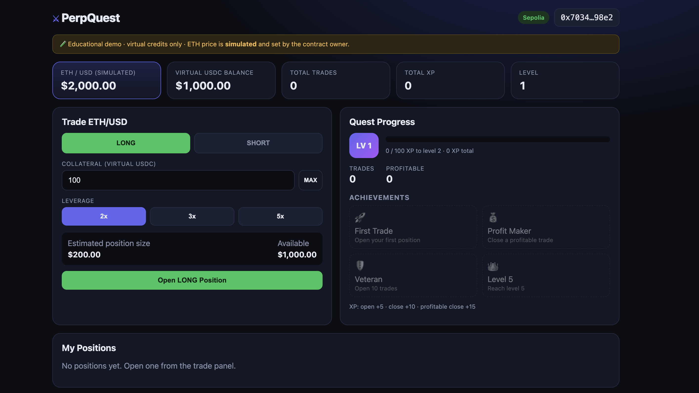
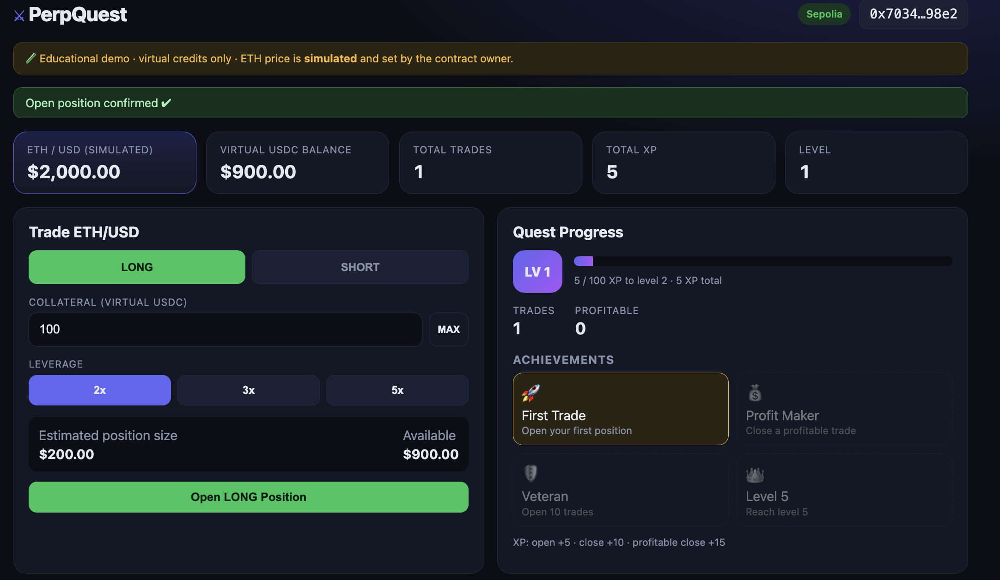

# PerpQuest ⚔

A gamified mini perpetual-trading dApp inspired by GMX. Users claim virtual USDC, open LONG/SHORT ETH/USD positions (2x/3x/5x), track PnL, and earn XP and badges.

> **Academic project. Virtual credits only. The ETH price is simulated and controlled by the contract owner.**

## Deployment

| | |
|---|---|
| Network | Ethereum **Sepolia** testnet (chain id 11155111) |
| Contract address | `0xeA8828843B0Eb7B6b61e29a175aab5C9019D4Ba6` |
| Etherscan | https://sepolia.etherscan.io/address/0xeA8828843B0Eb7B6b61e29a175aab5C9019D4Ba6 |

## Screenshots

### Dashboard and trading panel
<!-- Replace with your screenshot: docs/screenshots/dashboard.png -->


### Open positions with live PnL
<!-- docs/screenshots/positions.png -->



## Features

- MetaMask connect, Sepolia network check and one-click switch
- One-time claim of 1,000 virtual USDC (stored on-chain)
- LONG / SHORT ETH/USD with 2x, 3x or 5x leverage
- Live unrealized PnL read from the contract
- Close positions: collateral ± PnL, loss capped at collateral
- XP, levels, trade counts and 4 achievement badges
- Owner-only admin panel to change the simulated price
- All data (balance, positions, XP, PnL) comes from the deployed contract
- Loading, transaction-pending, success and error messages

## Tech stack

Solidity 0.8.24 · Foundry · React 18 + Vite · ethers.js v6 · MetaMask · Sepolia

## Smart contract (`contracts/src/PerpQuest.sol`)

| Item | Detail |
|---|---|
| Virtual USDC | 6 decimals, `claimCredits()` once per address |
| ETH price | 8 decimals, starts at $2,000, `setPrice()` owner only, emits `PriceUpdated` |
| Position | id, owner, isLong, collateral, leverage, size = collateral × leverage, entryPrice, timestamp, isOpen, exitPrice, realizedPnl |
| PnL | `size × (price − entry) / entry`, sign flipped for SHORT, floored at −collateral |
| Close | owner only, once only; credits `collateral + pnl` |
| XP | open +5, close +10, profitable close +15 |
| Level | `xp / 100 + 1` |
| Badges | First Trade, Profit Maker, Veteran (10 trades), Level 5 |

Main functions: `claimCredits`, `openPosition(isLong, collateral, leverage)`, `closePosition(id)`, `setPrice(price)`, `getPrice`, `getPnL(id)`, `getUserPositions`, `getStats`, `getLevel`, `getBadges`.

No liquidation engine: a loss beyond collateral is capped when the position is closed.

## Installation

Requirements: [Foundry](https://book.getfoundry.sh/getting-started/installation), Node 18+, MetaMask, Sepolia ETH from a faucet.

```bash
git clone <your-repo-url> perpquest
cd perpquest/contracts
forge install foundry-rs/forge-std
cd ../frontend
npm install
```

## Run tests

```bash
cd contracts
forge test -vv
```

30 tests cover credits, repeat-claim block, long/short open, leverage validation, PnL (both directions, loss cap), profitable and losing close, access control, double close, XP, levels and badges.

## Deploy to Sepolia

```bash
cd contracts
cp .env.example .env
# edit .env: SEPOLIA_RPC_URL, PRIVATE_KEY (testnet-only wallet!), optional ETHERSCAN_API_KEY
source .env
forge create src/PerpQuest.sol:PerpQuest \
  --rpc-url $SEPOLIA_RPC_URL \
  --private-key $PRIVATE_KEY \
  --gas-limit 8000000 \
  --broadcast
```

Note: on Sepolia, `forge script` ran out of gas because forge's estimate was too low, so a high explicit `--gas-limit` with `forge create` was used. Gas is nearly free on the testnet.

Confirm the deployment:

```bash
cast code <ADDRESS> --rpc-url $SEPOLIA_RPC_URL | head -c 80
cast call <ADDRESS> "owner()(address)" --rpc-url $SEPOLIA_RPC_URL
```

`.env` is git-ignored. Never commit private keys or seed phrases.

## Run the frontend

```bash
cd frontend
cp .env.example .env
# set VITE_CONTRACT_ADDRESS=0xeA8828843B0Eb7B6b61e29a175aab5C9019D4Ba6
npm run dev
```

Open the printed URL and connect MetaMask on Sepolia. The wallet that deployed the contract is the owner and sees the Admin panel.

## Demo flow

1. Connect MetaMask (Sepolia)
2. Claim 1,000 virtual USDC
3. Open a LONG with 100 USDC at 5x
4. As owner, set the price to 2200 → PnL turns positive
5. Close the position → balance, XP and badges update
6. Open another position, set the price to 1800 → loss shown, then close

## Project structure

```
perpquest/
├── contracts/   src, test, script, foundry.toml
├── frontend/    React + Vite app
├── docs/screenshots/
├── README.md
└── .gitignore
```

## Disclaimer

Educational demo. Virtual credits have no value. The price oracle is owner-controlled and not suitable for production.